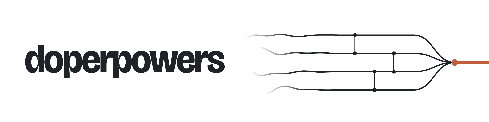
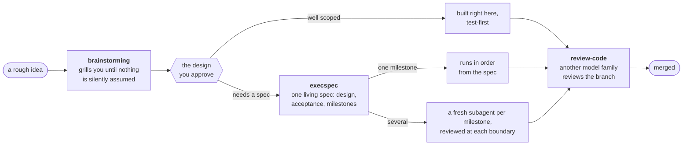
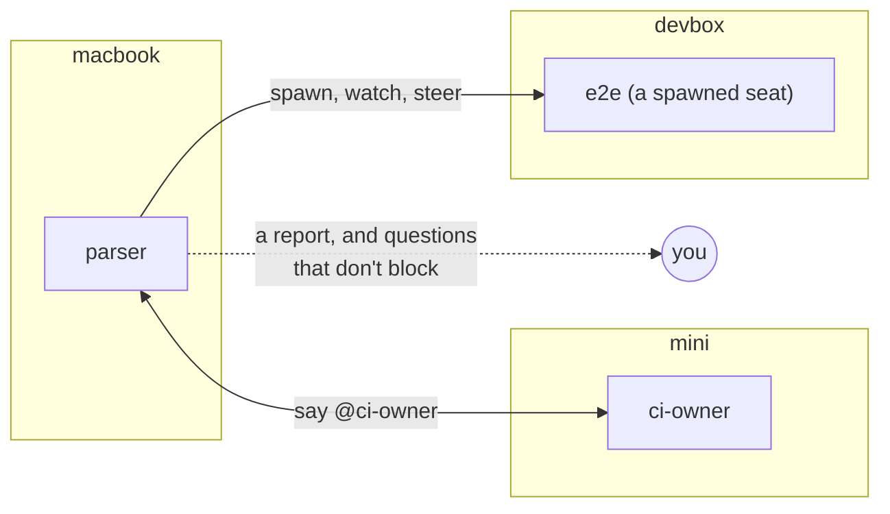

<p align="center">
  <picture>
    <source media="(prefers-color-scheme: dark)" srcset="docs/assets/banner-dark.png">
    
  </picture>
</p>

<p align="center">
  <b>Claude Code plugins for building software with agents.</b><br>
  <code>doperpowers</code> takes a change from a rough idea to a reviewed, merged branch.<br>
  <code>sminos</code> turns your sessions, on one machine or several, into a team that sees, messages and hands work to each other.
</p>

<p align="center">
  <a href="#install">Install</a> ·
  <a href="docs/whats-inside.md">What's inside</a> ·
  <a href="#what-to-expect">What to expect</a>
</p>

---

## doperpowers: one method for every change



- **It asks before it builds.** `brainstorming` explores what the work should be and grills you in batched rounds while you are there, then presents the design. Nothing that commits a product or design decision is built before you approve it.
- **One living spec, when the work needs one.** `execspec` writes a single document that carries the design with its reasoning, acceptance as observable behavior, and the plan of work as milestones. It is reviewed before it runs and kept current while it runs: progress, decisions, surprises, and a retrospective at the end.
- **The shape follows the size.** A well-scoped change is built in the session. A one-milestone spec runs in order. Several milestones each go to a fresh subagent (`subagent-driven-execution`), built test-first and reviewed at every dependency boundary, so your session stays the design session.
- **Review by a different model.** `review-code` sends the finished branch to an independent reviewer from another model family, sized by the stakes: one reviewer for a focused diff, a multi-lens panel with a binding verifier for a large one.
- **It keeps going.** Between your approval and the merge the agent doesn't stop to ask what's next. It comes back when it meets a decision the design didn't cover.

You don't call any of this by hand: every skill says when it applies, and the agent checks before it starts.

## sminos: your sessions, as a team

Run more than a couple of Claude Code sessions and they start stepping on each other: two of them edit the same file, one waits on a fact another already found, and you become the message bus. sminos makes every session in a project a member that knows the others.

```text
$ sminos list
api
  parser    [7a11ce01]  interactive  busy  @macbook  api@parser-rewrite  in charge: the new parser        · active 2m
  ci-owner  [a45b97a3]  interactive  idle  @mini     api@main            in charge: CI and the release    · active 14m
  e2e       [2b52e44a]  seat         busy  @devbox   api@e2e-flakes      in charge: the flaky e2e suite   · active now
you: parser [7a11ce01]

$ sminos say "@ci-owner the parser rewrite renames the tokens table; hold the release"
```



- **Who's here, and what they own.** `sminos list` shows every session in the project: its machine, branch, state and the line it is in charge of. A project is every clone and worktree of one repository, on every enrolled machine.
- **Messages instead of copy-paste.** `sminos say "@parser …"` reaches that session wherever it runs; `@all`, a machine, or the whole org work too.
- **Spawn and drive.** `sminos spawn` starts a background session (a seat) on a task; `watch`, `steer`, `interrupt`, `answer` and `decide` reach into one that is running.
- **Every commit names its author session.** Commits and PRs end with a `Sminos-Session:` line, and `sminos who <commit|PR>` finds that session and how to reach it.
- **Questions that don't block.** A session asks you through an async question tool and keeps working until you answer.
- **Catch up in one read.** The `manager` skill follows the sessions you name and tells you what they need from you and what you missed.

`to-human` comes with it: a session writes you a report, message by message, and the terminal folds its working record (tool calls, scratch notes) behind a button, so you read what the session says to you instead of its transcript.

## Install

In Claude Code:

```text
/plugin marketplace add SSFSKIM/doperpowers
/plugin install doperpowers@doperpowers
/plugin install sminos@doperpowers
/plugin install to-human@doperpowers
```

Then, in `~/.claude/settings.json`, turn on function hooks (sminos's bridge and question tool, and the to-human view, are built on them) and put the plugins' hooks in order:

```json
{
  "env": { "CLAUDE_CODE_ENABLE_FUNCTION_HOOKS": "1" },
  "prependPlugins": ["to-human@doperpowers", "sminos@doperpowers", "doperpowers@doperpowers"],
  "outputStyle": "doperpowers:to-human"
}
```

`outputStyle` is optional: leave it out to keep reading the transcript. Spanning machines takes one more step, a git mirror or a desk hub: see [sminos's setup guide](sminos/skills/sminos/references/setup.md). Updating, and how this coexists with other marketplaces: [`docs/INSTALL-doperpowers.md`](docs/INSTALL-doperpowers.md).

## What to expect

This is one person's daily setup, published as it runs. It moves fast (the plugin version is past 7.200) and is shaped by how its maintainer works, so a few things are worth knowing up front:

- **Some agents are pinned to models served through a local gateway.** The `review-code` reviewers and a few others run on another model family (`sol`, `astra` in [`agents/`](agents/)). Without that gateway, point their `model:` lines at models you have.
- **Built for Claude Code.** sminos, to-human and the hooks are Claude Code plugins. The skills also ship as a local [Codex plugin](.codex-plugin/), with [ports of the agent definitions](codex/agents/README.md); upstream's other harness adapters were dropped.
- **The board is a backlog.** `issue-tracker` keeps deferred work as GitHub issues that a session takes when you name one. The unattended pipeline that once dispatched agents onto tickets [is dormant](docs/doperpowers/specs/2026-10-18-board-dispatch-dormant.md): a session working with you proved faster and more reliable.

Every skill, agent and hook is listed in [What's inside](docs/whats-inside.md).

## Credits and license

doperpowers started as a fork of [obra/superpowers](https://github.com/obra/superpowers) by Jesse Vincent and has since been rebuilt around the living spec, cross-model review and multi-session work. Code from upstream stays under its MIT license ([`LICENSE`](LICENSE)); files this fork created are under [`LICENSE-FORK`](LICENSE-FORK); [`NOTICE`](NOTICE) says which is which.

Skills here are behavior-shaping code, not prose: changing one changes what the agent does, so changes go through the `writing-skills` skill and get tested. Issues and ideas: [github.com/SSFSKIM/doperpowers/issues](https://github.com/SSFSKIM/doperpowers/issues).
